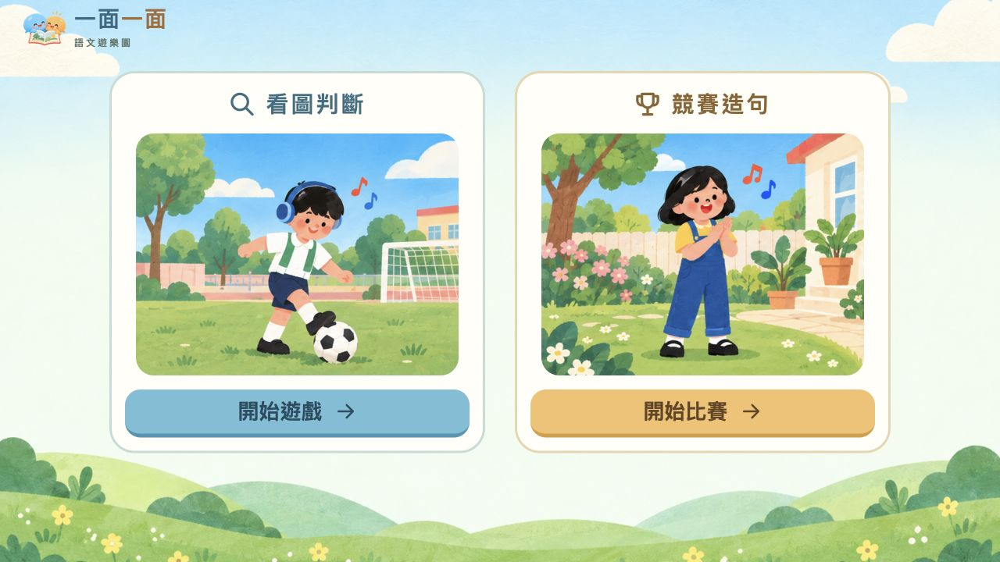
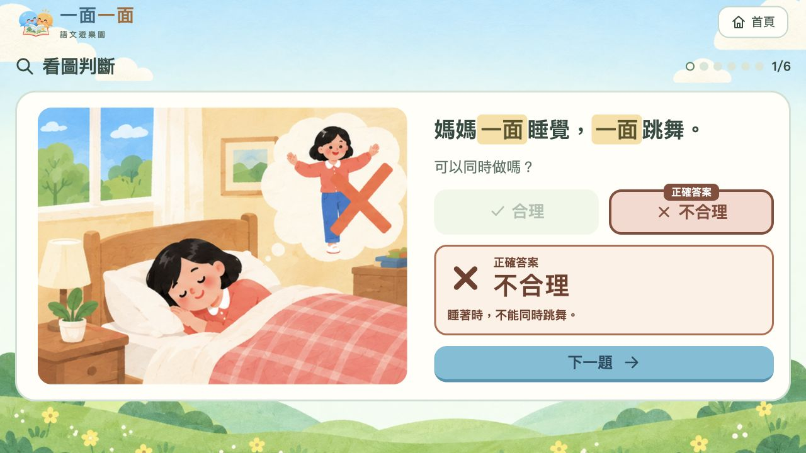
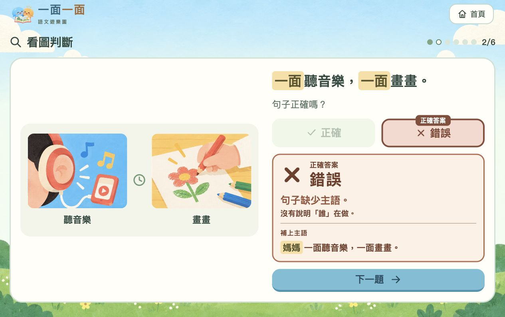
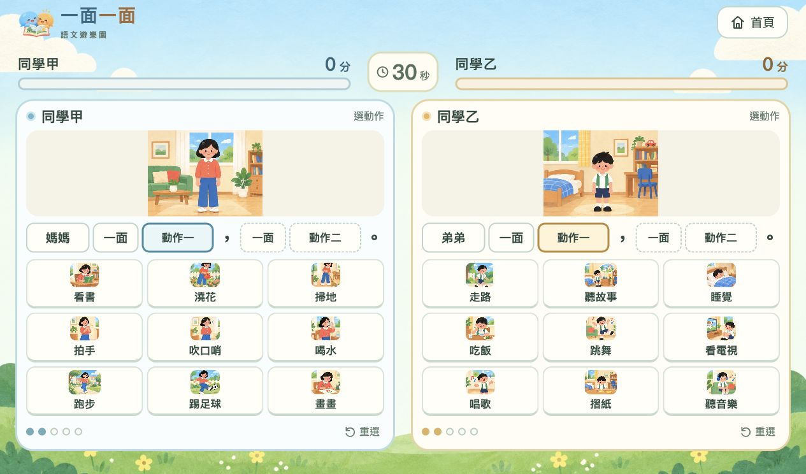
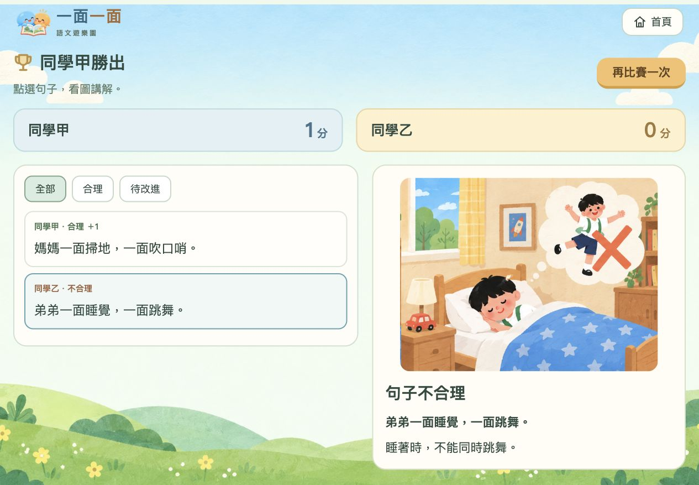

# 一面一面・語文遊樂園

本專案是一款供小學二年級學生學習「一面……一面……」句式的互動網頁程式。遊戲以繪本風格插圖配合簡短文字，透過「看圖判斷」及「競賽造句」兩個環節，協助學生理解同時進行的動作、辨識句子的主語，並練習組成完整而合理的句子。

**[開啟線上遊戲（固定網址）](https://angusqaq.github.io/yi-mian-yi-mian-game/)** · **[下載單檔離線 HTML](https://github.com/angusQAQ/yi-mian-yi-mian-game/releases/download/offline-v1/yi-mian-yi-mian-offline.html)**

線上版由 GitHub Pages 託管，無須保持本機電腦開啟。保留本儲存庫及 Pages 設定，即可持續使用上述固定網址。



## 適用對象與課堂安排

| 項目 | 說明 |
| --- | --- |
| 適用對象 | 小學二年級學生，亦適合需要圖像及基礎語文支援的學生 |
| 學習內容 | 「一面……一面……」句式、主語及動作之間的合理關係 |
| 操作人數 | 每次由兩位學生在電子白板前操作；其餘學生可觀察、預測及參與討論 |
| 遊戲形式 | 看圖判斷可由教師安排輪流作答；競賽造句由兩位學生同時操作 |
| 設備 | 電子白板、觸控螢幕，或可使用滑鼠的電腦及瀏覽器 |
| 文字呈現 | 繁體中文書面語，配合人物、動作詞卡及情境插圖 |

## 學習目標

完成練習後，學生應能：

1. 說出「一面……一面……」表示兩件事在同一時間進行。
2. 找出句子中的人物，知道主語說明「誰」在做。
3. 根據圖片，判斷兩個動作能否由同一人物同時進行。
4. 使用人物、兩個「一面」及兩個不同的動作，組成完整而合理的句子。

## 句型與判斷重點

本遊戲的造句框架為：

> （人物）一面（動作一），一面（動作二）。

例如：**媽媽一面聽音樂，一面掃地。**

| 句子 | 本練習的判斷重點 |
| --- | --- |
| 媽媽一面聽音樂，一面掃地。 | 有主語，兩個動作可以同時進行 |
| 弟弟一面睡覺，一面踢足球。 | 有主語，但兩個動作不能同時進行 |
| 一面唱歌，一面跳舞。 | 動作可以同時進行，但沒有說明誰在做，需補上主語 |

主語題以沒有前文提示的獨立完整句子為練習情境，要求學生明確寫出人物。教師可引導學生依次檢查：「誰在做？」「做哪兩件事？」「可以同時做嗎？」

## 遊戲一：看圖判斷

### 玩法

1. 在首頁選擇「看圖判斷」，點選「開始遊戲」。
2. 觀察圖片及句子。每回合共有六題，包括兩題合理、兩題不合理及兩題缺少主語。
3. 動作判斷題選擇「合理」或「不合理」；主語題選擇「正確」或「錯誤」。
4. 作答後，查看正確答案、圖片及簡短原因。即使答錯，也可直接點選「下一題」。
5. 完成六題後，查看本回合答對的題數。

題目圖片在作答前不加上勾號或交叉提示。作答後，圖片依題目的正確答案呈現；答錯時，正確選項及答案會醒目顯示，方便教師即時講解。



### 利用主語題教學

缺少主語的題目採用動作特寫，淡化人物身分。學生需要留意句子是否說明「誰」在做，而不只是判斷動作是否合理。

例如，出現「一面聽音樂，一面畫畫。」時，教師可依次提問：

1. 「句子提到了哪兩個動作？」
2. 「這兩個動作可以同時進行嗎？」
3. 「句子有沒有說明誰在做？」
4. 「如果補上『媽媽』，完整句子應怎樣說？」

學生作答後，畫面會指出缺少主語，並示範補上人物。教師可再請其他學生更換主語，口頭說出另一個完整句子。



## 遊戲二：競賽造句

### 玩法

1. 在首頁選擇「競賽造句」，查看圖像說明後點選「開始比賽」。
2. 系統先倒數三秒，再開始六十秒的比賽。
3. 兩位玩家在左右兩個遊戲區獨立操作，依次選取「人物→一面→動作一→一面→動作二」。
4. 點選詞卡時，上方圖片會隨已選取的內容改變。逗號及句號已預先填入，無須另外選取。
5. 五張詞卡選取完成後，系統自動判斷句子。完整且合理的句子可獲得一分。
6. 點選「下一句」繼續造句；需要調整錯誤句子時，可使用「修改動作」。上方分數及積分槽會顯示雙方表現。
7. 時間結束後，進入結果及句子回顧畫面。

### 詞彙及計分規則

- 詞庫共有十八個動作。每場分為兩組，每位玩家各有九個，雙方的動作詞彙完全不重複。
- 同一場比賽中，每位玩家的九個動作保持固定；選取第二個動作時，不會根據第一個動作篩除選項。
- 選項保留合理及不合理的搭配，由學生自行判斷。
- 同一人物搭配相同的兩個動作，每位玩家只計分一次；交換兩個動作的先後順序，不會重複得分。
- 本遊戲要求選取兩個不同的動作；重複選取同一動作、不合理的搭配及未完成的句子均不計分。



## 利用賽後回顧教學

結果畫面保留本回合出現的完整句子，包括合理、不合理及重複的句子；未完成的句子另作標示。教師可點選句子，查看相關圖片及解釋。

建議依下列順序講解：

1. **找出完整的合理句子**：請學生指出主語、兩個「一面」及兩個動作。
2. **說明不合理的原因**：引導學生觀察圖片，說出哪些動作互相衝突。
3. **口頭修正句子**：保留人物及其中一個動作，請學生更換另一個動作，再說出完整句子。
4. **補全未完成的句子**：先找出缺少的部分，再請學生完成句子。

重複句子未再次計分，不等於句子的語文表達錯誤；教師可藉此鼓勵學生嘗試不同組合。



## 建議課堂流程

以下為約十七分鐘的教學安排，可按學生需要調整：

| 環節 | 時間 | 教師引導與學生任務 |
| --- | --- | --- |
| 圖像引入 | 兩分鐘 | 展示一個合理情境，先說出人物及兩個動作，再示範用兩個「一面」連接 |
| 看圖判斷 | 四分鐘 | 兩位學生輪流操作；全班先作預測，再根據答案圖片說明原因 |
| 主語補全 | 兩分鐘 | 利用缺少主語的題目，追問「誰在做？」，請學生補上人物並說出完整句子 |
| 競賽造句 | 三分鐘 | 兩位學生進行六十秒競賽；其他學生觀察句子是否有主語，以及動作能否同時進行 |
| 賽後講解 | 四分鐘 | 選取合理及不合理的句子作比較，請學生指出原因並口頭修正 |
| 個人練習 | 兩分鐘 | 每位學生自行說出或寫出一個完整而合理的「一面……一面……」句子 |

### 學習支援與觀察

- 對需要較多支援的學生，先讓其指認圖片，再選取人物及動作詞卡，最後說出完整句子。
- 學生答錯時，先回到圖片及句子中的具體部分提問，避免只要求重複記住答案。
- 觀察學生能否說明「誰、同時做哪兩件事」，並分辨「缺少主語」與「動作不合理」。
- 評量時，除了分數，也應留意學生的口頭解釋及修正後的句子。

## 線上與離線使用

| 版本 | 使用方式 |
| --- | --- |
| 線上版 | 開啟[固定遊戲網址](https://angusqaq.github.io/yi-mian-yi-mian-game/)，無須安裝或登入 |
| 單檔離線版 | [下載 HTML 檔案](https://github.com/angusQAQ/yi-mian-yi-mian-game/releases/download/offline-v1/yi-mian-yi-mian-offline.html)後，以瀏覽器開啟；可複製至其他電腦使用 |

離線檔案約八十三 MiB，內含全部題目、程式及二十九張圖集。離線版保存發布當時的內容；網站更新後，需要重新製作及下載離線版，才會包含更新內容。

## 程式組成與本機預覽

本程式使用原生 HTML、CSS 及 JavaScript 製作，透過 GitHub Pages 提供靜態網頁服務。遊戲無須資料庫或第三方圖像生成 API，所有插圖均已預先製作。

| 檔案或資料夾 | 用途 |
| --- | --- |
| `index.html` | 遊戲入口 |
| `app.js` | 主頁、看圖判斷及主語題 |
| `race.js` | 雙人競賽、計時、計分及賽後回顧 |
| `play.css` | 版面及視覺樣式 |
| `data.json` | 人物、十八個動作、三百二十四種有序搭配判斷及主語題 |
| `art.json`、`art/` | 圖集索引及插圖素材 |
| `docs/screenshots/` | README 使用的實際遊戲截圖 |
| `tools/` | 單檔離線版的製作及驗證工具 |

下載原始碼後，可在專案根目錄執行：

```sh
python3 -m http.server 8873 --bind 127.0.0.1
```

然後開啟 `http://127.0.0.1:8873/`。原始碼版本需要透過 HTTP 載入 JSON；已下載的單檔離線 HTML 則可直接以瀏覽器開啟。

重新製作及檢查離線版：

```sh
python3 tools/build_single_html.py
node tools/test_single_html.cjs
```

生成檔案位於 `build/yi-mian-yi-mian-offline.html`。

## 網站更新與資料保存

GitHub Pages 使用 `main` 分支的根目錄。修改、測試並推送至 `main` 後，GitHub 會重新部署，遊戲沿用同一個固定網址。

分數及句子紀錄僅保存在當前頁面，重新載入後便會清除。遊戲沒有登入、錄音或上傳學生資料的功能。

插圖由 ChatGPT 內建圖像工具生成，採用兒童繪本風格；生成提示詞保留於 `docs/`。本 README 的截圖取自實際上線版本，題目、詞彙分配及分數會隨每次遊戲改變。
